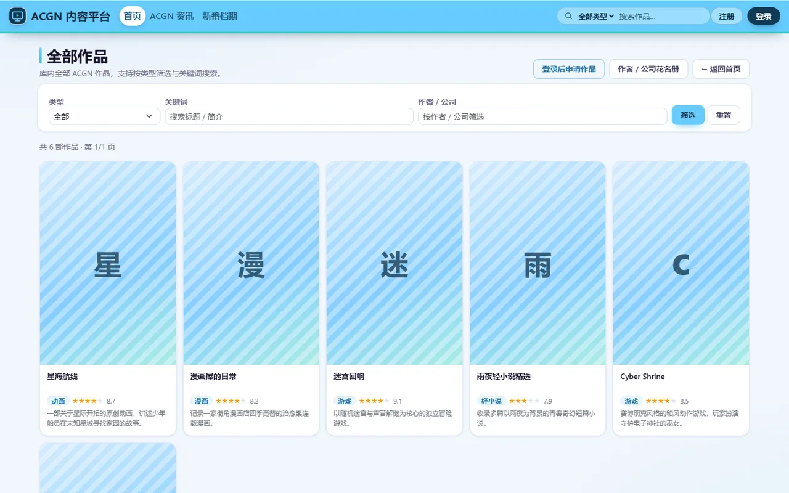
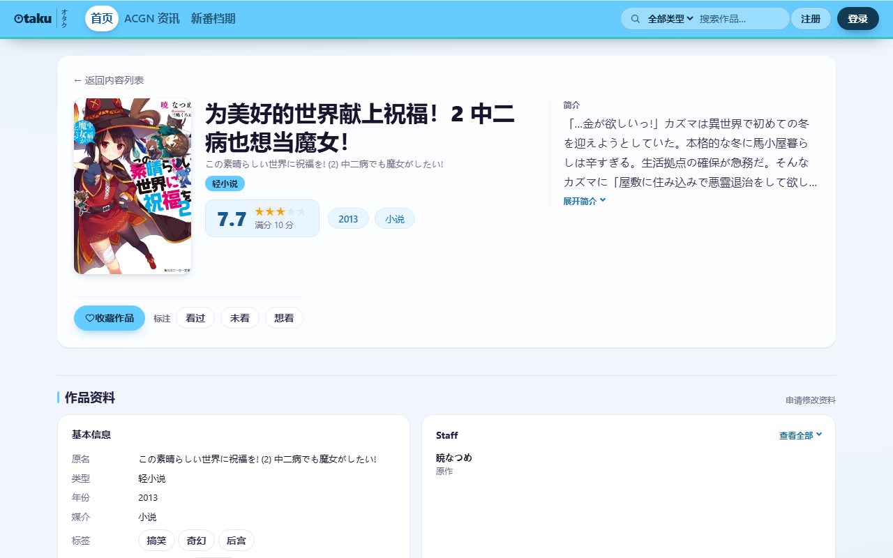
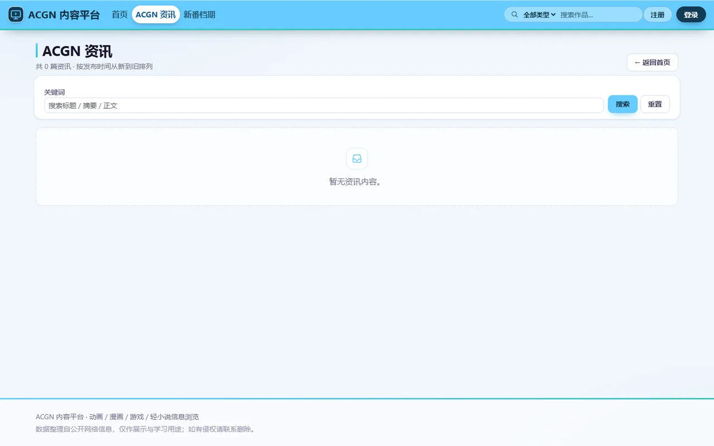
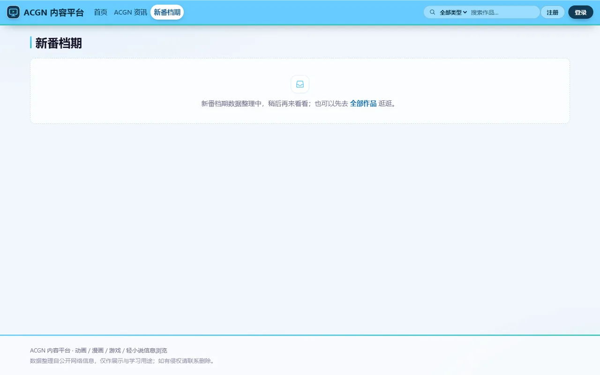
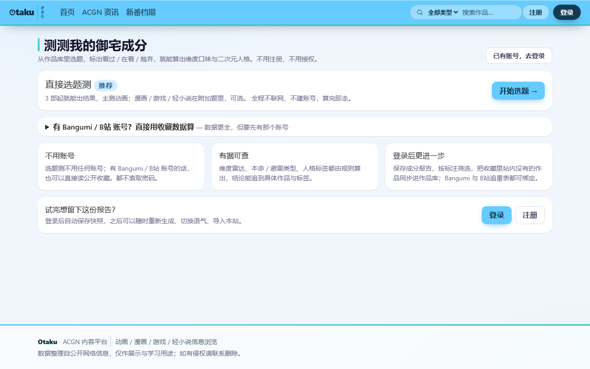
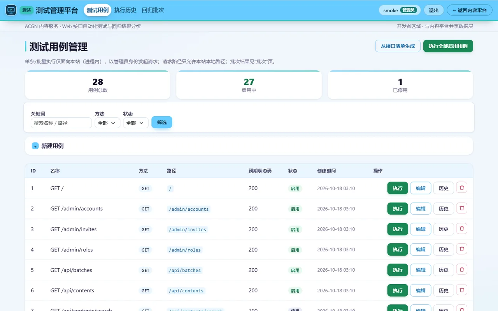
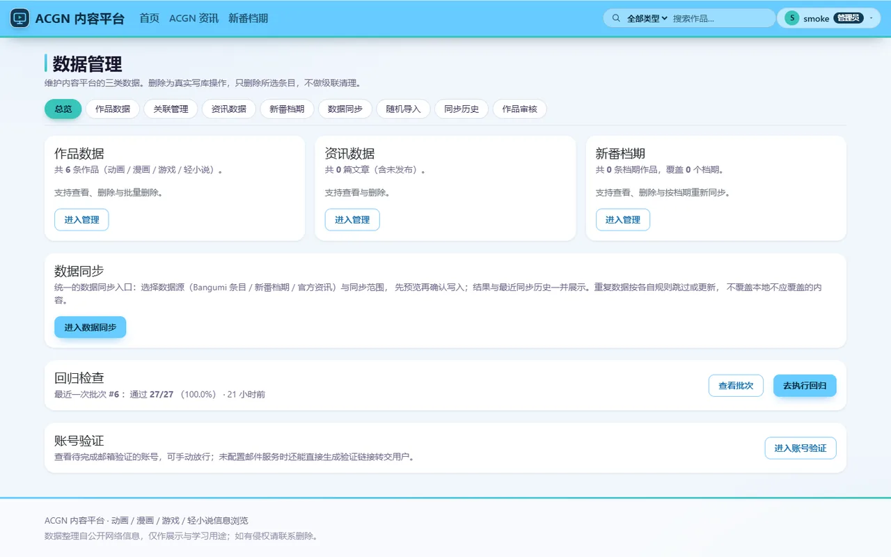
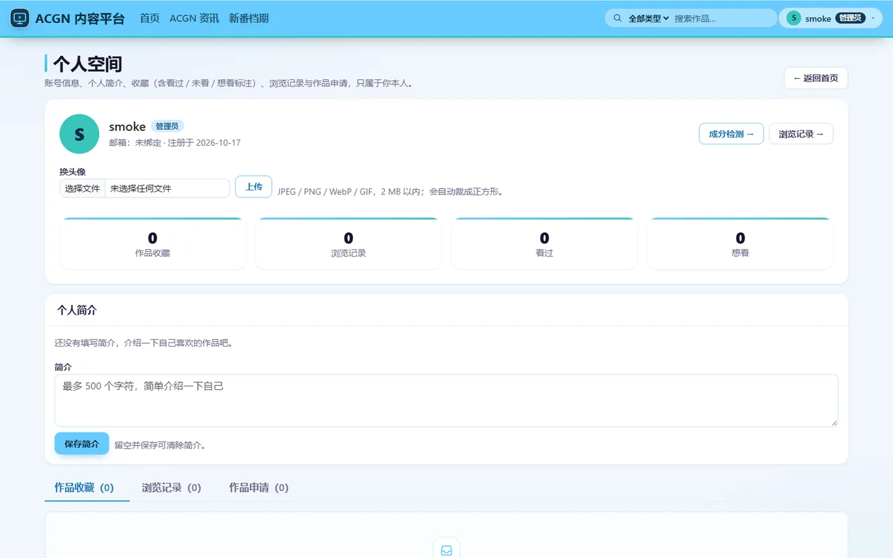

# Otaku —— ACGN 内容平台与接口自动化测试后台

**Otaku** 是一个 ACGN 内容平台（动画 / 漫画 / 游戏 / 轻小说的作品库、资讯与档期）。

一个 FastAPI 应用，里面装了一半能正常浏览的 ACGN 内容站，和一半给这些接口做回归的自动化测试后台。同进程、同数据库，但页面布局和权限各走各的：内容站对所有人开放，测试后台只有管理员能进。

最早的起点其实只有后半块。2026 年 3 月它是一套给自家接口做回归用的小工具，内容站压根是为了给测试造点真实数据才顺手弄的，结果越长越大，现在反而是站更像主角。

## 版本更新

- **v0.1（2026-03）** 用例管理、进程内执行、批次间回归对比。当时没有页面，全靠 curl 和 pytest 脚本。
- **v0.2（2026-04）** 给测试后台补了 Web 页面。同进程、同库，页面与 API 各走各的路由，这个骨架一直用到现在。
- **v0.3（2026-05）** 内容站就是从这儿长出来的：作品 / 资讯 / 新番档期三张表，配上 Bangumi、Aniplex、Yuc.wiki 三个抓取脚本。
- **v0.4（2026-06）** 补齐门户那一套：分类入口、关键词搜索、作品详情、标签筛选。到这时候它已经不像个配角了。
- **v0.5（2026-07）** 账号与权限。三级角色、服务端会话、注册与邮箱验证、找回密码、邀请码；公开注册默认关掉，走邀请制。
  （2026-10 起：注册改为「填邮箱 → 收 6 位验证码 → 填验证码 → 设密码 → 建号即登录」，邮箱在建号前验证；
  邮件走 Gmail SMTP（587 + STARTTLS），配置见 [docs/gmail-smtp-setup.md](./docs/gmail-smtp-setup.md)；邀请码改为可选。）
- **v0.6（2026-08）** 个人空间和阿宅画像。收藏（看过 / 未看 / 想看的标注跟收藏是同一行数据）、浏览记录、头像，以及读 Bangumi 公开收藏算出的六维雷达和 LLM 锐评。
- **v0.7（2026-09）** 三个散装同步表单收拢成统一编排：预览 → 确认写入，顺带把词条申请审核和标签归一也做了。
- **v0.8（2026-10 上旬）** 封面本地化（按需派生缩略图）、作品关系识别，以及用例从接口清单自动生成。
- **v1.0（2026-10 中旬）** 部署上线。页面 / API / 同步 / 备份都跑通了，测试用例也攒到 990 多项。
- **v1.1（2026-11 初）** 御宅成分检测：维度 / 阈值 / 评分逻辑完善，新增文案质量护栏（`scripts/lint_persona_copy.py` 体检 + `tests/test_persona_copy.py` 断言）。视觉资产系统化：App 图标与 PWA 图标统一到「圆环 O + 星芒」品牌基因——小尺寸 favicon 用符号版，大尺寸用渐变底白字 Otaku 字标，配 `app/static/manifest.webmanifest` 支持手机主屏安装（资源见 `app/static/img/otaku-*.svg`）。
- **v1.2（2026-11-17）** 测试平台补上判定与统计口径：四态判定 + 判定快照、身份隔离、用例生命周期（待确认 / 驳回）、带参样本与异常用例；结果分析页给出失败归因、路由分组和耗时观察；批次趋势与失败复跑（疑似不稳定从回归中扣除，但不改通过率）。老批次保持 legacy 口径，不被新规则改写。

## 界面截图

先看图有个概念就行，都是 1440×900 截的。作品的封面是本地还没抓图时的占位样式，跑过 `fetch_covers.py` 之后会换成真封面：

| 页面 | 截图 | 页面 | 截图 |
|---|---|---|---|
| 首页 `/` |  | 作品库 `/contents` |  |
| 作品详情 `/contents/{id}` |  | 资讯 `/articles` |  |
| 新番档期 `/schedule` |  | 阿宅画像（免登录试算） |  |
| 测试后台（管理员） |  | 数据管理（管理员） |  |
| 个人空间 `/me` |  | | |

## 功能

**内容站（公开）**

`/contents` 能按类型筛、按关键词搜、按标签归类，翻页也还算顺手；作品详情页里除了标签，还有制作信息、角色声优和同系列作品。资讯走的是 Aniplex 官方新闻站，导入时会自动识别题材标签、作品信息（作者 / 公司 / 系列 / 译名）并跟站内作品关联上——标题没出现的作品，也能靠作者、公司与系列名反查补上。`schedule` 是按季度切换的新番档期。

登录后多了 `/me`：收藏、浏览记录、头像、词条申请进度都在那儿。资料与凭据另开一页 `/settings`（账号设置，入口在右上角头像菜单）：个人资料（性别 / 生日 / 所在地 / 简介）在 `/settings/profile`，邮箱与手机的绑定、更换、解绑在 `/settings/security`。另外 `/persona` 填个 Bangumi 用户名就能免登录试算画像，登录后可以绑定，生成六维雷达和 LLM 锐评文案。

**测试后台（仅管理员）**，还是当年那套路子。入口在 `/testcases`（用例）、`/batches`（批次历史与趋势）、`/analysis`（结果分析）；生成与确认用例走 `/testcases/generate`。

- 用例增删改查，单条执行，或者把启用的用例整批跑成一个批次。判定分 `pass / fail / redirect / not_run` 四态，以批次快照为准；每次跑批都对用例集合留一份快照，快照恒等式（启用 = 已执行 + 未执行）由单测钉住
- 批次之间能拉出来对比，看哪些从通过变成了失败；失败后自动同批复跑两次，只在「首次失败 + 连续两次通过」时标「疑似不稳定」并从回归计数里扣除，通过率仍按首次结果算；复跑不一致的单独列一类，不猜根因
- 「结果分析」页按错误前缀把失败自动归成五类（判不了落 To Investigate），给路由分组 × 批次矩阵，以及耗时最长的前 N 条用例；单条执行的失败与批次失败分开统计
- 用例有生命周期（probing → pending_review → active / rejected）：「从接口清单生成」只产探测用例，确认后才进 active；已确认的预期值不再被再次生成自动覆盖，出现差异只报告。身份分匿名 / staff / owner，按身份建独立会话，身份不可用时记 `not_run / identity_unavailable`，不发请求也不降级
- 执行器跑在应用进程里（`TestClient` 发请求），只认本站本地路径，够不着外部地址
- 「从接口清单生成」扫一遍全部只读且不带路径参数的路由，自动生成冒烟用例；另有一组人工判断的异常用例（越权、带参边界、不存在 id），默认待确认

## 快速开始

Python 3.13，默认 SQLite，不装额外服务就能跑。

```powershell
python -m venv .venv
.\.venv\Scripts\Activate.ps1
pip install -r requirements.txt
copy .env.example .env
python -m uvicorn app.main:app --reload --host 127.0.0.1 --port 8000
```

内容站在 <http://127.0.0.1:8000/>，测试后台在 <http://127.0.0.1:8000/testcases>。

首次启动会建表，按需要写一份开发用的种子数据（`SEED_DEMO_DATA=false` 就换成干净库），再按 `.env` 里的内容建初始账号——库里已经有账号时它不会动。日常维护账号可以这样：

```powershell
python scripts/create_user.py --list
python scripts/create_user.py --username alice --role admin
```

> 部署场景下记得先用 `.env` 覆盖默认口令和 `AUTH_SECRET_KEY`，顺便确认 `.env` 没被提交上去。

数据除了在后台「数据同步」里点，也可以直接跑脚本：

```powershell
python scripts/import_bangumi.py --help       # 作品条目
python scripts/sync_yuc_schedule.py --help    # 新番档期
python scripts/import_articles.py --help      # 官方资讯
```

作品条目取的是 [bangumi/Archive](https://github.com/bangumi/Archive) 的每周全量导出和 Bangumi API；档期来自 [Yuc.wiki](https://yuc.wiki/)；资讯正文抓自 [ANIPLEX NEWS BOX](https://news.aniplex.co.jp/)。

## 项目结构

```
app/
  main.py            # FastAPI 应用和路由装配
  models.py          # SQLAlchemy 模型
  crud.py            # 数据访问，外加建表时的幂等补列
  auth.py            # 会话、口令、角色
  api.py             # JSON API（/api/**）
  *_pages.py         # 服务端渲染的页面
  templates/         # Jinja2 模板
scripts/             # 抓取、同步、封面、账号维护
tests/               # pytest，每个用例跑在独立临时库上
conftest.py
```

## 开发

```powershell
python scripts/devtest.py     # 日常默认：只跑与当前改动相关的测试文件
python scripts/devtest.py --collect   # 只看会跑哪些文件及原因，不执行
pytest -q                     # 全量 1690 项，约 8 分钟，慎跑
ruff check .
```

先说最容易踩的两个坑。一是这项目**没有 Alembic**，加列得写成 `crud.init_db()` 里的幂等 `ALTER`（照着 `ensure_user_email_columns` 写），只改模型是没用的。二是 `conftest.py` 默认把测试里的联网关掉了，依赖外部站点的用例要自己 monkeypatch。环境变量都收在 `app/config.py`，常用的几个是 `DATABASE_URL`、`AUTH_SECRET_KEY`、`SEED_DEMO_DATA`、`REGISTRATION_MODE`、`COVER_STORAGE_DIR`。

## 已知限制

内容站和测试后台共用一个进程一个库，测试后台的写入会落在同一份数据上。用例执行器只认本站本地路径，拿它测外部服务是不行的。数据库也没有迁移工具，升级靠 `init_db` 里的幂等 DDL——上面提过一嘴，这里再啰嗦一遍。

关于测试平台的统计口径，几点要说在前面：老批次（没有判定快照的）一律标 legacy、按旧公式回退，不回填也不改写历史记录；「疑似不稳定」只是同批两次复跑的启发式观察，不是严格 flaky 判定，复跑结果不覆盖首次、不进通过率；「最慢用例」是进程内 `TestClient` 的耗时观察，受机器负载和首次导入影响，不是性能基准，不做达标判定也不跨批比趋势。归因是读错误文本前缀自动归一，判不了的落 To Investigate，不猜根因。

## License

MIT，见 [LICENSE](./LICENSE)。
