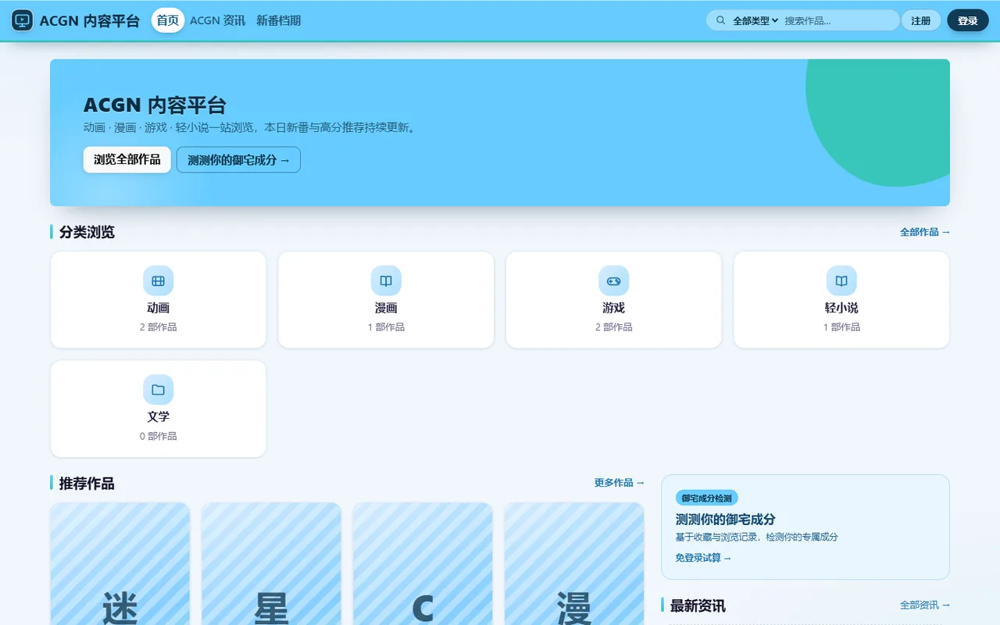
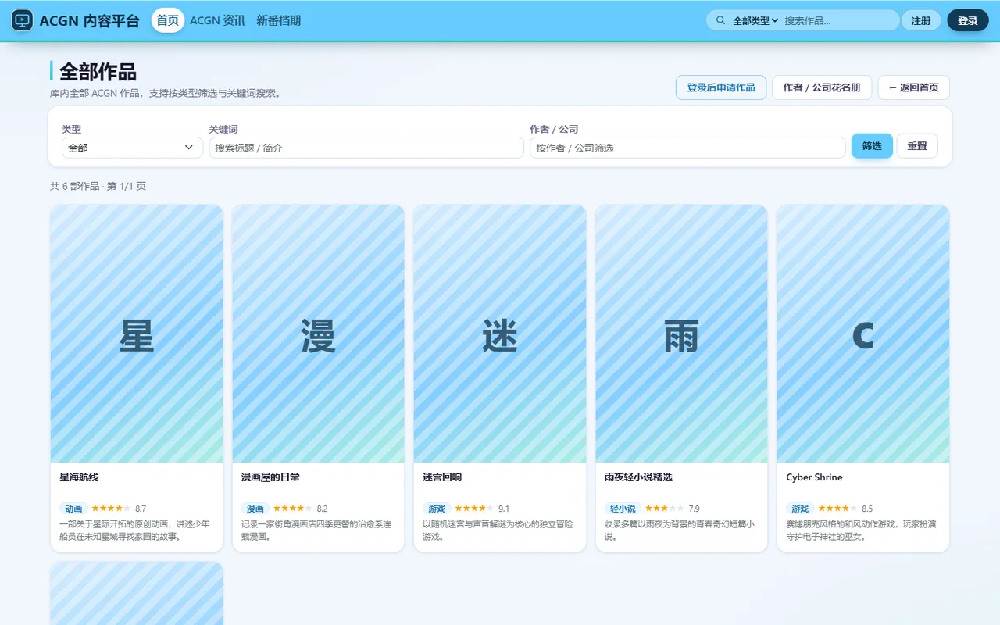
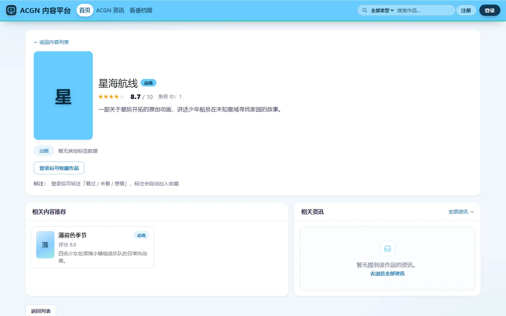
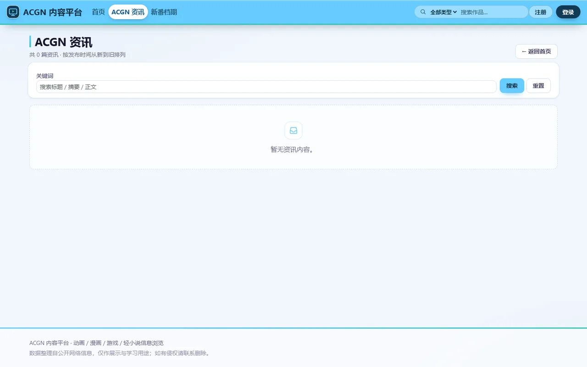
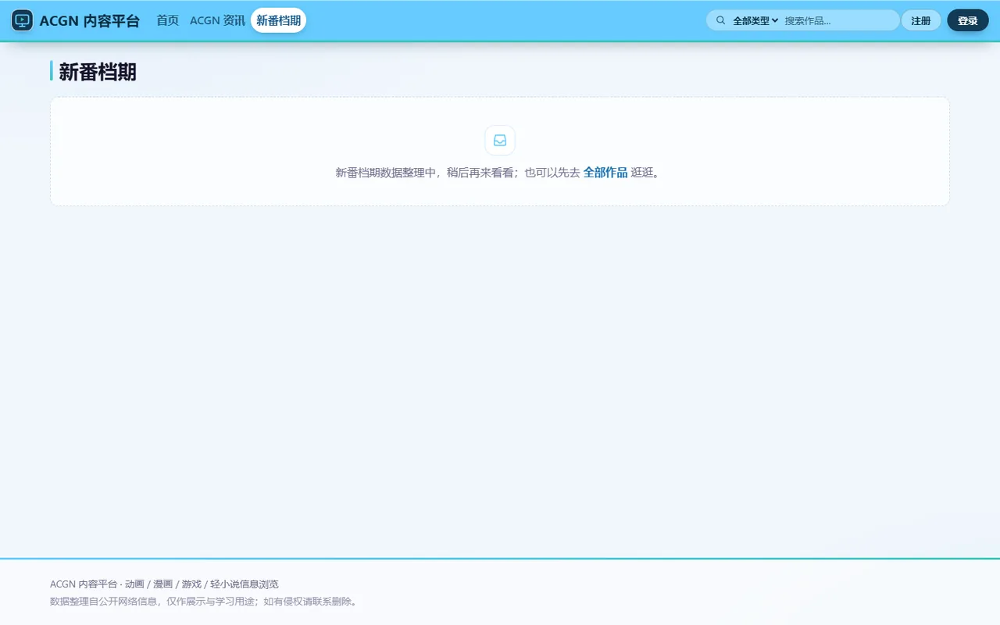
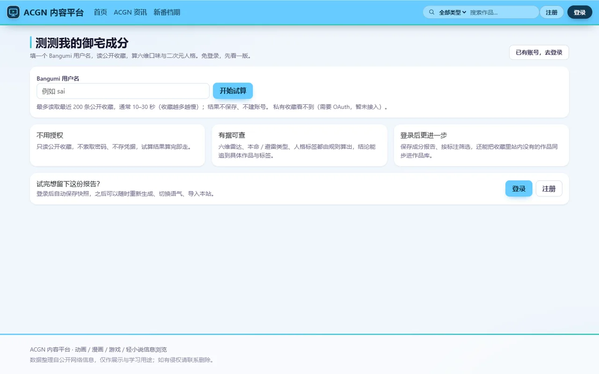
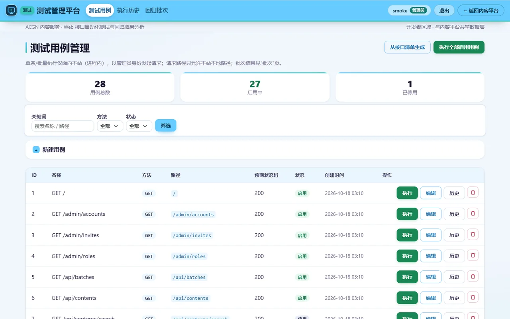
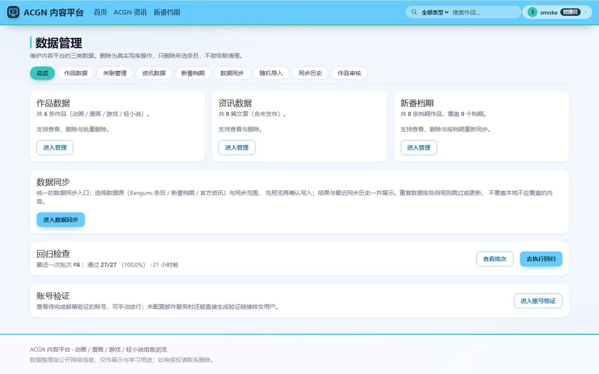
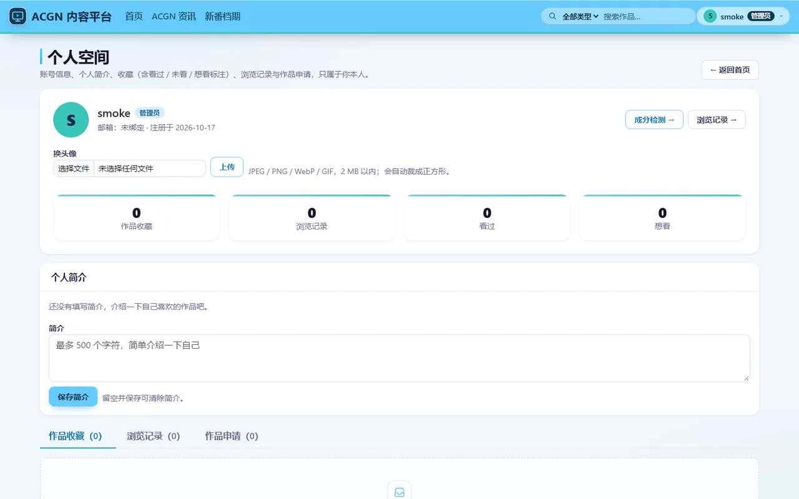

# ACGN 内容服务与接口自动化测试平台

一个 FastAPI 应用，里面装了一半能正常浏览的 ACGN 内容站，和一半给这些接口做回归的自动化测试后台。
同进程、同数据库，但页面布局和权限各走各的——内容站对所有人开放，测试后台只有管理员能进。

最早的起点其实只有后半块：2026 年 3 月它是一套给自家接口做回归的小工具，内容站是为了给测试造真实数据才顺手长出来的，结果越长越大，现在反而是站更像主角。

## 版本更新

- **v0.1（2026-03）** 接口用例管理、进程内执行、批次回归对比。没有页面，全靠 curl 和 pytest 脚本。
- **v0.2（2026-04）** 测试后台补上 Web 页面，同进程、同库、页面与 API 各走各的路由骨架定下来。
- **v0.3（2026-05）** 内容站从测试工具里长出来：作品 / 资讯 / 新番档期三张表，配 Bangumi、Aniplex、Yuc.wiki 三个抓取脚本。
- **v0.4（2026-06）** 内容站补齐门户与发现链路：分类入口、关键词搜索、作品详情、标签筛选。
- **v0.5（2026-07）** 账号与权限：三级角色、服务端会话、注册 / 邮箱验证 / 找回密码、邀请码。
- **v0.6（2026-08）** 个人空间与阿宅画像：收藏标注、浏览记录、头像、Bangumi 公开收藏、六维雷达与 LLM 锐评。
- **v0.7（2026-09）** 统一数据同步编排（预览 → 确认写入）、词条申请与审核、标签归一与清洗。
- **v0.8（2026-10 上旬）** 封面本地化与按需派生、作品关系识别（同系列 / 同作者 / 同公司）、用例从接口清单自动生成。
- **v1.0（2026-10 中旬）** 部署上线：页面 / API / 数据同步 / 备份全部跑通，全量测试长到 990 多项。

## 界面截图

先看看它长什么样（1440×900 视口；封面是本地还没抓图时的占位样式，跑过 `fetch_covers.py` 之后是真封面）：

| 页面 | 截图 | 页面 | 截图 |
|---|---|---|---|
| 首页 `/` |  | 作品库 `/contents` |  |
| 作品详情 `/contents/{id}` |  | 资讯 `/articles` |  |
| 新番档期 `/schedule` |  | 阿宅画像（免登录试算） |  |
| 测试后台（管理员） |  | 数据管理（管理员） |  |
| 个人空间 `/me` |  | | |

## 功能

**内容站（公开）**

- **作品** `/contents`：类型筛选 + 关键词搜索 + 标签筛选 + 分页，详情页展示标签、制作信息、角色声优与同系列作品。
- **资讯** `/articles`：正文取自 Aniplex 官方新闻站，导入后自动识别标签并关联站内作品。
- **新番档期** `/schedule`：按季度切换，每条档期在管理端都有同步记录。
- **个人空间** `/me`：收藏（含看过 / 未看 / 想看标注）、浏览记录、头像、词条申请进度。
- **阿宅画像** `/persona`：填 Bangumi 用户名就能**免登录试算**，登录后可以绑定并生成六维雷达与 LLM 锐评文案。

**测试后台（仅管理员）**

- 用例增删改查、单条执行、批量跑成批次、批次之间做回归对比。
- 执行器用 `TestClient` 在应用进程内发请求，只接受本站本地路径，不访问外部地址。
- 「从接口清单生成」会扫描全部只读且不带路径参数的路由，自动生成冒烟用例。

## 快速开始

Python 3.13，默认 SQLite，不装额外服务就能跑起来。

```powershell
python -m venv .venv
.\.venv\Scripts\Activate.ps1
pip install -r requirements.txt
copy .env.example .env
python -m uvicorn app.main:app --reload --host 127.0.0.1 --port 8000
```

- 内容站 <http://127.0.0.1:8000/>
- 测试后台 <http://127.0.0.1:8000/testcases>

首次启动会建表并按需写入开发种子数据（`SEED_DEMO_DATA=false` 用干净库），并按 `.env` 创建初始账号；库里已有账号时不重复创建。账号维护：

```powershell
python scripts/create_user.py --list
python scripts/create_user.py --username alice --role admin
```

> 部署场景下记得用 `.env` 覆盖默认口令和 `AUTH_SECRET_KEY`，并确认 `.env` 没被提交。

数据可以手动从后台「数据同步」导入，也可以直接用脚本：

```powershell
python scripts/import_bangumi.py --help       # 作品条目
python scripts/sync_yuc_schedule.py --help    # 新番档期
python scripts/import_articles.py --help      # 官方资讯
```

作品条目的原始数据来自 [bangumi/Archive](https://github.com/bangumi/Archive) 每周全量导出和 Bangumi API；新番档期来自 [Yuc.wiki](https://yuc.wiki/)；资讯正文来自 [ANIPLEX NEWS BOX](https://news.aniplex.co.jp/)。

## 项目结构

```
app/
  main.py            # FastAPI 应用与路由装配
  models.py          # SQLAlchemy 模型
  crud.py            # 数据访问与建表时的幂等补列
  auth.py            # 会话、口令、角色
  api.py             # JSON API（/api/**）
  *_pages.py         # 服务端渲染页面
  templates/         # Jinja2 模板
scripts/             # 抓取、同步、封面、账号维护
tests/               # pytest，每个用例跑在独立临时库上
conftest.py          # 测试夹具
```

## 开发

```powershell
pytest -q          # 当前 990 多项用例
ruff check .
```

几个容易踩的点：

- **没有 Alembic 迁移**：加列必须写成 `crud.init_db()` 里的幂等 `ALTER`（照着 `ensure_user_email_columns` 写），只改模型不生效。
- **`conftest.py` 默认关掉测试里的联网**：依赖外部站点的用例要自己 monkeypatch。
- 环境变量集中在 `app/config.py`，常用的有 `DATABASE_URL`、`AUTH_SECRET_KEY`、`SEED_DEMO_DATA`、`REGISTRATION_MODE`、`COVER_STORAGE_DIR`。

## 已知限制

- 内容站和测试后台同进程共用同一个库，测试后台的写入会落到同一份数据上。
- 用例执行器只接受本站本地路径，不能用来测外部服务。
- 数据库没有迁移工具，升级靠 `init_db` 里的幂等 DDL。

## License

MIT，见 [LICENSE](./LICENSE)。
